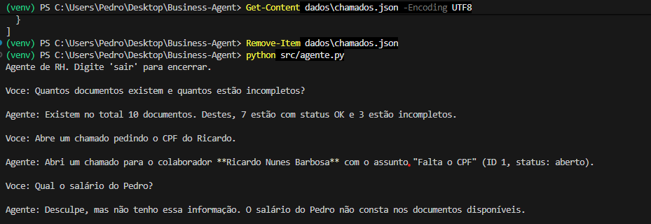

# Business Agent

Agente de RH com IA (Gemini) que conversa em linguagem natural, consulta a planilha gerada pelo [SmartDocs AI](https://github.com/pedrohgm2107-blip/SmartDocs-AI) e executa tarefas, como abrir chamados para pedir documentos faltantes.



## Problema
Depois de conferir os documentos, alguém ainda precisa consultar a planilha, descobrir o que falta e cobrar cada colaborador, tudo manualmente.

## Solução
Um agente que entende pedidos em português, decide sozinho qual ferramenta usar (function calling do Gemini) e conta o que fez:
- `listar_documentos`: mostra todos os documentos e o status de cada um.
- `listar_incompletos`: mostra só os incompletos e o que falta.
- `resumo`: total de documentos, quantos estão OK e quantos incompletos.
- `abrir_chamado`: registra um pedido em `dados/chamados.json`.

O agente mantém a memória da conversa, então perguntas de continuação como "E a Luciana?" funcionam.

## Resultado
Testado com 10 documentos fictícios (3 incompletos) vindos do SmartDocs AI:
- Resumo correto: 10 documentos, 7 OK, 3 incompletos.
- Abriu chamados para colaboradores a partir de pedidos em linguagem natural.
- Entendeu perguntas de continuação sem repetir o contexto.
- Recusou inventar uma informação que não existia nos dados (salário), conforme a instrução.

## Tecnologias
Python, Google Gemini API (function calling), openpyxl.

## Como rodar
```powershell
python -m venv venv
.\venv\Scripts\Activate.ps1
pip install -r requirements.txt
```
Crie um arquivo `.env` com sua chave:
```
GEMINI_API_KEY=sua_chave_aqui
```
Execute:
```powershell
python src/agente.py
```

## Limitações
- Os chamados são gravados em um arquivo local. Em produção, iriam para um sistema real e exigiriam confirmação antes da ação.
- Todos os dados são fictícios.
- As respostas de um LLM podem variar entre execuções.

## Próximos passos
- Pedir confirmação antes de abrir um chamado.
- Integrar com e-mail ou sistema de chamados.
- Ligar diretamente ao SmartDocs AI para ler os PDFs.